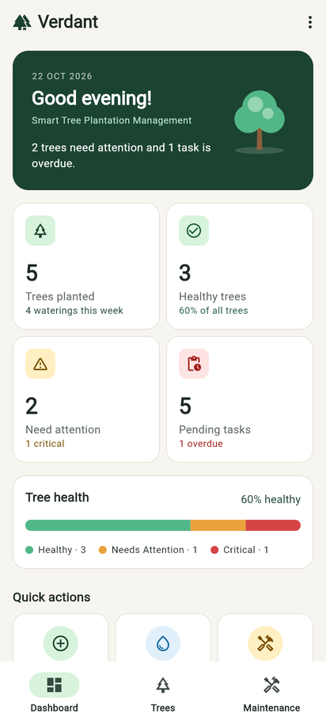
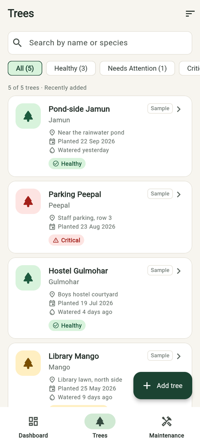
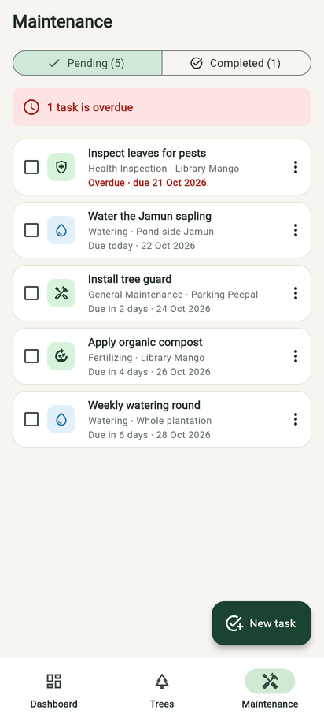
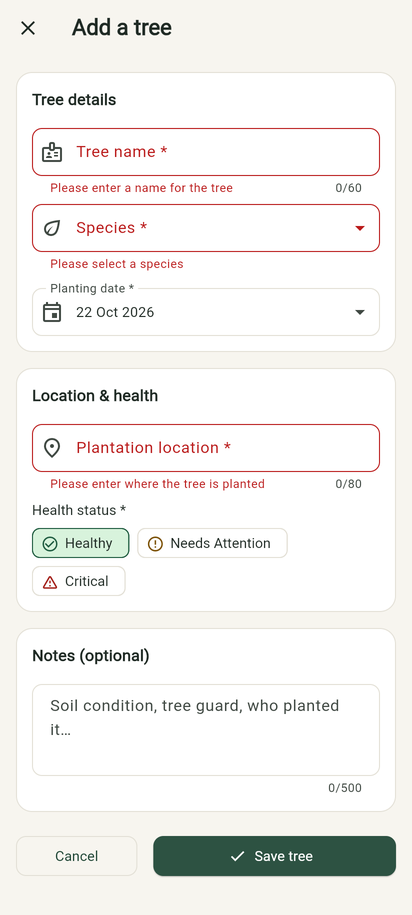
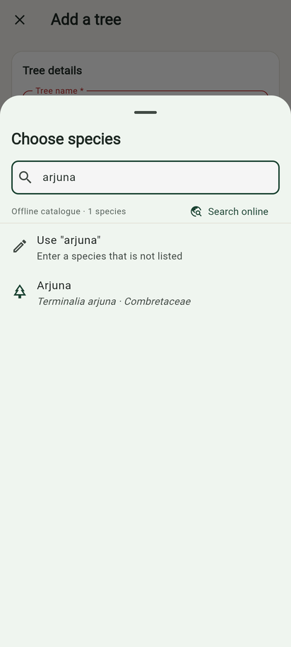
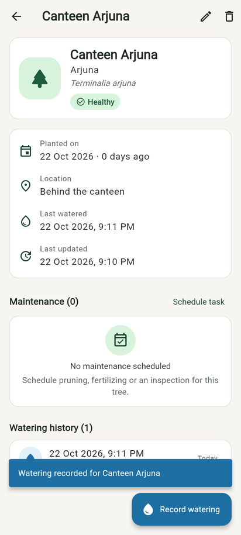

# Verdant — Smart Tree Plantation Management System

A Flutter mobile application for planning, tracking and maintaining trees planted
during a plantation drive (for example a college campus greening programme).
It records every tree, its health, watering history and scheduled maintenance,
and summarises everything on a dashboard. All data is stored on the device and the
app works fully offline.

Repository: <https://github.com/Anirudh-vitb/verdant-smart-tree-plantation-flutter>

| Dashboard | Trees | Maintenance |
|---|---|---|
|  |  |  |

| Form validation | Species picker | Tree details |
|---|---|---|
|  |  |  |

> Screenshots were captured from the web build of this exact code, in Chromium at a
> phone-sized viewport (412 × 915).

---

## 1. Problem statement

Tree plantation drives often plant hundreds of saplings, but many of them die in the
first year because nobody tracks them afterwards. Volunteers do not know
which saplings were watered, which ones are sick, or what maintenance is due.
Paper registers and spreadsheets are hard to update in the field and give no quick
overview.

## 2. Proposed solution

A simple, offline-first mobile app that lets a coordinator or volunteer:

- register every planted tree with its species, location, planting date and health;
- log each watering;
- schedule and complete maintenance tasks (watering, fertilizing, pruning, inspection);
- see at a glance how many trees are healthy, which need attention and what work is pending.

## 3. Main features

| Area | What you can do |
|---|---|
| **Dashboard** | Greeting and plain-language summary; live counts of trees planted, healthy trees, trees needing attention and pending tasks; a stacked health bar; quick actions (add tree, record watering, open maintenance); upcoming watering tasks; recently added trees; empty states when there is no data. All numbers are calculated from stored data. |
| **Trees** | List all trees; search by name, species or scientific name; filter by health (Healthy / Needs Attention / Critical) with counts; sort by recently added, name, or planting date; open details. |
| **Add / edit tree** | Validated form: name, species (searchable picker), planting date (date picker, no future dates), location, health status, optional notes. Save/cancel, success message, and a "discard changes?" prompt if you try to leave with unsaved edits. |
| **Tree details** | Name, species and scientific name, health badge, planting date and age, location, last watered, last updated, notes, maintenance tasks for that tree, full watering history. Edit, delete (with confirmation), record watering and schedule a task from here. |
| **Watering records** | Log date and time, optional quantity (litres) and duration (minutes), and notes. Validated input. Updates the tree history and the dashboard immediately. It only *records* the activity; it does not control any irrigation hardware. |
| **Maintenance** | Pending / Completed views with counts; overdue warning; create, edit, complete (checkbox), re-open, and delete (with confirmation) tasks; task types: Watering, Fertilizing, Pruning, Health Inspection, General Maintenance; optionally assign a task to a tree. |
| **Navigation** | Bottom navigation bar on phones and a navigation rail on wide screens (≥ 840 px). Tabs keep their state (search text, filters) when you switch. Back on a non-dashboard tab returns to the dashboard. |
| **Persistence** | Data is saved on the device with `shared_preferences` as JSON and survives app restarts. Corrupted records are skipped individually instead of crashing the app. |
| **Sample data** | Five sample trees and six tasks are added on first launch, marked **Sample**. Remove them (or load them again) from the ⋮ menu on the dashboard. Removing them also removes anything you attached to a sample tree; your own trees and their records are kept. |
| **Species lookup** | 30-species offline catalogue (always available) plus an optional "Search online" button that queries the free GBIF Species API, with automatic fallback to the offline list. See [API contract](docs/API_CONTRACT.md). |

## 4. Technologies used

| Technology | Purpose |
|---|---|
| Flutter 3.47.7 / Dart 3.13.5 | UI framework and language |
| Material 3 | Design system (custom forest-green theme) |
| [`provider`](https://pub.dev/packages/provider) 6.1 | State management with `ChangeNotifier` |
| [`shared_preferences`](https://pub.dev/packages/shared_preferences) 2.5 | Local key-value persistence |
| [`intl`](https://pub.dev/packages/intl) 0.20 | Date formatting |
| [`http`](https://pub.dev/packages/http) 1.6 | Optional online species lookup |
| `flutter_test` | Unit and widget tests |

No paid services, API keys or remote databases are used.

## 5. Prerequisites

- Flutter SDK **3.47.x** (Dart 3.13) — tested with 3.47.7 stable
- For Android: Android Studio (or the Android command-line tools) with an Android SDK, plus an emulator or a USB-debugging phone
- Git

## 6. Setup on Windows (PowerShell)

```powershell
# 1. Clone the repository
git clone https://github.com/Anirudh-vitb/verdant-smart-tree-plantation-flutter.git
cd verdant-smart-tree-plantation-flutter

# 2. Check your Flutter installation
#    (if flutter is not on PATH, use the full path to flutter.bat in your SDK's bin folder)
flutter --version
flutter doctor

# 3. Download dependencies
flutter pub get
```

## 7. Running the app

```powershell
# List connected devices / running emulators
flutter devices

# Start an Android emulator (name from `flutter emulators`)
flutter emulators --launch <emulator_id>

# Run on the connected device
flutter run

# Or run in Chrome (useful for a quick demo on a laptop)
flutter run -d chrome
```

Build an installable APK:

```powershell
flutter build apk --release
# Output: build\app\outputs\flutter-apk\app-release.apk
```

## 8. Running tests and analysis

```powershell
flutter analyze
flutter test
```

The suite contains **63 tests** (unit and widget). They use in-memory storage and
mocked HTTP, so they need no device, no internet and do not touch real user data.

| Test file | Covers |
|---|---|
| `test/models_test.dart` | JSON serialization of trees, tasks and watering records; validation of bad data; overdue logic |
| `test/tree_query_test.dart` | Search, health filter and sorting |
| `test/storage_test.dart` | Save/load, corrupted and invalid JSON handling, persistence across instances, first-run seeding |
| `test/providers_test.dart` | Add / edit / delete tree, record watering, create / complete / edit / delete task, cascade delete, sample-data removal, failed-save rollback |
| `test/dashboard_stats_test.dart` | Dashboard statistic calculations |
| `test/species_service_test.dart` | Offline catalogue; GBIF request format, parsing, and fallback on error, timeout, offline and bad JSON |
| `test/widgets_test.dart` | Dashboard numbers and empty states, tree form validation, add/edit/delete flows, search and filters, unsaved-changes prompt, watering sheet, maintenance create/complete, adaptive navigation |

## 9. Folder structure

```
lib/
├── main.dart                  # Entry point: opens storage, seeds sample data, runs the app
├── app.dart                   # Root widget: theme + providers
├── app_environment.dart       # Start-up facts shared with the UI (e.g. storage warning)
├── core/
│   ├── theme/                 # AppColors, AppTheme, AppSpacing
│   └── utils/formatters.dart  # Date formatting and ID generation
├── data/
│   ├── sample_data.dart       # First-run demonstration records
│   └── species_catalogue.dart # Offline species list
├── models/                    # Plain Dart data classes (no Flutter UI code)
│   ├── tree.dart              # Tree + HealthStatus
│   ├── watering_record.dart
│   ├── maintenance_task.dart  # MaintenanceTask + TaskType
│   ├── species.dart
│   ├── tree_query.dart        # Search / filter / sort logic
│   └── dashboard_stats.dart   # Dashboard calculations
├── services/
│   ├── local_storage_service.dart # JSON persistence over a key-value store
│   └── species_service.dart       # Offline catalogue + optional GBIF lookup
├── providers/
│   ├── tree_provider.dart         # Trees and watering records (ChangeNotifier)
│   ├── maintenance_provider.dart  # Maintenance tasks (ChangeNotifier)
│   └── plantation_actions.dart    # Operations that span both providers
├── screens/
│   ├── shell/home_shell.dart      # Bottom bar / navigation rail
│   ├── dashboard/                 # Dashboard + health summary chart
│   ├── trees/                     # List, details, form, species picker, watering sheet
│   └── maintenance/               # Task list, task form, shared task actions
└── widgets/                       # Reusable UI: cards, badges, empty state, dialogs, form fields
test/                              # Unit and widget tests
docs/                              # Architecture, API contract, demo guide, syllabus mapping
```

## 10. Data model

```
Tree 1 ──── * WateringRecord        (WateringRecord.treeId → Tree.id)
Tree 1 ──── * MaintenanceTask       (MaintenanceTask.treeId → Tree.id, optional)
```

**Tree** — `id`, `name`, `species`, `scientificName?`, `plantedOn`, `location`,
`health` (`healthy` | `needsAttention` | `critical`), `notes`, `createdAt`,
`updatedAt`, `isDemo`.

**WateringRecord** — `id`, `treeId`, `wateredAt`, `quantityLitres?`,
`durationMinutes?`, `notes`, `isDemo`.

**MaintenanceTask** — `id`, `title`, `type` (`watering` | `fertilizing` | `pruning` |
`inspection` | `general`), `treeId?` (null = whole plantation), `dueDate`, `notes`,
`isCompleted`, `completedAt?`, `createdAt`, `updatedAt`, `isDemo`.

IDs are generated on the device (`tree-<timestamp>-<counter>`) and never change.
Deleting a tree also deletes its watering records and tasks, so no record points to
a missing tree.

## 11. Architecture overview

```
Screens (widgets)  ──read/watch──▶  Providers (ChangeNotifier)  ──▶  LocalStorageService  ──▶  SharedPreferences
       ▲                                   │                                (JSON)
       └───────── notifyListeners() ───────┘
```

- **Models** are plain Dart classes with `toJson` / `fromJson`.
- **Services** handle I/O (device storage, network) and know nothing about widgets.
- **Providers** are the single source of truth. Every change is written to storage
  *first*; only if that succeeds is the in-memory list updated and listeners notified.
  So the UI never shows data that was not saved.
- **Screens** call provider methods and rebuild automatically through
  `context.watch`. The dashboard computes `DashboardStats` from the providers, so
  numbers update the moment a tree or task changes.

Full explanation: [docs/ARCHITECTURE.md](docs/ARCHITECTURE.md).

## 12. API and offline fallback

Species selection always works offline, using the bundled catalogue of 30 common
trees. The optional **Search online** button calls the free, key-less
[GBIF Species API](https://techdocs.gbif.org/en/openapi/v1/species)
(`GET https://api.gbif.org/v1/species/suggest?q=<text>&rank=SPECIES&limit=20`).
If the request fails, times out (8 s) or returns unexpected data, the app shows a
message and falls back to the offline list. You can also type any custom species name.

**Verification status:** the GBIF client is unit-tested against mocked responses that
follow GBIF's documented format. It could **not** be tested against the live service,
because the build environment's network policy blocked `api.gbif.org`. Try it on a
real device with internet access. See [docs/API_CONTRACT.md](docs/API_CONTRACT.md).

## 13. Screens and navigation

```
HomeShell (bottom navigation / rail)
├── Dashboard ──▶ Add tree form, Record watering sheet, Task form, Tree details
├── Trees     ──▶ Tree details ──▶ Edit tree form, Record watering sheet, Task form
│             └─▶ Add tree form ──▶ Species picker sheet
└── Maintenance ──▶ Task form (new / edit)
```

## 14. Limitations

- Data is stored on one device only. There is no login, no cloud sync and no sharing between volunteers.
- No photos of trees and no GPS coordinates. The location is free text.
- No push notifications for due tasks; overdue tasks are highlighted inside the app.
- The online species search depends on GBIF's public service, which may change or be rate-limited. GBIF returns scientific names only, not local common names.
- The UI uses a light theme only and English text only.

## 15. Future enhancements

- Firebase / Firestore sync so a whole team can share one plantation
- Photo capture to document tree growth over time
- GPS tagging and a map view of all trees
- Local notifications for due and overdue maintenance
- Export reports (PDF/CSV) for the college or municipal authorities
- Dark mode and multilingual UI (for example Hindi)

---

Made as a third-year B.Tech Full Stack / UI project.
